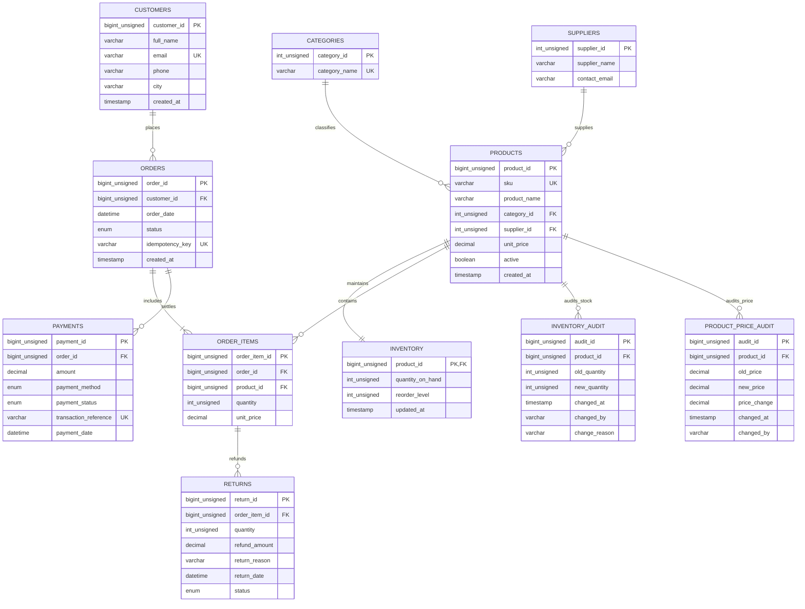

# Enterprise Retail Management Database System

[](https://www.mysql.com/)
[](LICENSE)
[](https://dev.mysql.com/doc/refman/8.0/en/innodb-storage-engine.html)

A production-grade, relational retail database system engineered in MySQL 8.0. This repository implements an end-to-end e-commerce data architecture featuring ACID transactions, row-level locking (`SELECT ... FOR UPDATE`), idempotency control, financial payment reconciliation, automated triggers, window functions, and performance benchmarking on 100,000+ records.

---

## 📁 Repository Structure

```
Retail_management/
├── README.md                                 # Root documentation & architecture guide
├── create_db.sql                             # Master DDL schema with comments & constraints
├── insert.sql                                # Baseline seed data
├── verify_row_cout.sql                       # Verification script for table row counts
├── constraint_testing.sql                    # Positive and negative constraint test suite
├── performed_operations.sql                  # Administrative schema inspection queries
├── benchmark_100k_data.sql                   # 100,000 synthetic order items dataset
│
├── labs/                                     # Core Lab Curriculum (Modular SQL files)
│   ├── lab03_filtering_sorting.sql           # Lab 3: Filtering, Sorting, Strings, Dates
│   ├── lab04_safe_update_delete.sql          # Lab 4: Safe transactional UPDATE & DELETE patterns
│   ├── lab05_joins.sql                       # Lab 5: Inner, Left & Multi-table Joins
│   ├── lab06_aggregations.sql                # Lab 6: Aggregations, GROUP BY, HAVING, AOV
│   ├── lab07_subqueries_window.sql           # Lab 7: Subqueries, CTEs, Window Functions (RANK, ROW_NUMBER)
│   ├── lab08_views.sql                       # Lab 8: Reporting Views (Order Sales, Stock, Customer Summary)
│   ├── lab09_indexing_explain.sql            # Lab 9: EXPLAIN plans and index analysis
│   ├── lab10_transactions_sp.sql             # Lab 10: ACID Inventory Reservation Procedure
│   ├── lab11_audit_trigger.sql               # Lab 11: Automated Inventory Audit Trigger
│   ├── lab12_payment_reconciliation.sql      # Lab 12: Independent CTE Payment Reconciliation
│   ├── lab13_low_stock_report.sql            # Lab 13: Operational Low-Stock Procurement Report
│   ├── lab14_customer_orders_sp.sql          # Lab 14: Customer Order History Stored Procedure
│   ├── lab15_security_rbac.sql               # Lab 15: Least Privilege RBAC & Grant Management
│   ├── lab16_backup_restore.sh               # Lab 16: Automated mysqldump backup & restore utility
│   └── lab17_acceptance_tests.sql            # Lab 17: Acceptance & Data Integrity Validation Suite
│
└── assignments/                              # Student Assignments (10 Complete Implementations)
    ├── assignment01_returns.sql              # 1: Returns tracking & Net Sales Calculation
    ├── assignment02_tax_discounts.sql        # 2: Order discounts & 18% GST tax calculation model
    ├── assignment03_monthly_report.sql       # 3: Dynamic monthly sales report procedure with filters
    ├── assignment04_lag_growth.sql           # 4: Month-over-month growth analytics using LAG()
    ├── assignment05_top_products_by_category.sql # 5: Top 5 products by category via DENSE_RANK()
    ├── assignment06_price_audit.sql          # 6: Product price change audit table & trigger
    ├── assignment07_idempotency.sql          # 7: Idempotent order placement procedure with UUID token
    ├── assignment08_concurrency_test.md      # 8: Dual-session concurrency & row locking simulation
    ├── assignment09_benchmark.py             # 9: 100,000 synthetic records generator & benchmarks
    └── assignment10_system_docs.md           # 10: System assumptions, constraints & limitations
```

---

## 🏛️ Entity-Relationship Diagram (ERD)



---

## 🚀 Quickstart & Setup Guide

### 1. Database Creation & Seeding
```bash
# Connect to MySQL and create schema
mysql -u root -p < create_db.sql

# Seed initial seed data
mysql -u root -p < insert.sql

# Verify initial row counts
mysql -u root -p < verify_row_cout.sql
```

### 2. Run Tests & Validation
```bash
# Verify constraints (Positive & Negative Test Cases)
mysql -u root -p < constraint_testing.sql

# Execute full acceptance test suite
mysql -u root -p < labs/lab17_acceptance_tests.sql
```

### 3. Generate 100,000 Synthetic Benchmark Records
```bash
# Generate benchmark SQL dataset (100k items across 25k orders)
python3 assignments/assignment09_benchmark.py

# Load dataset and execute query benchmarks
mysql -u root -p < benchmark_100k_data.sql
```

---

## ✅ Corporate Project Deliverable Checklist

- [x] **Schema and relationships documented in an ER diagram** (`README.md`, `assignment10_system_docs.md`)
- [x] **All constraints tested with valid and invalid data** (`constraint_testing.sql`)
- [x] **At least 25 business queries reviewed and validated** (Distributed across Labs 3, 5, 6, 7, 8, 12, 13 and Assignments 1–5)
- [x] **Views tested for correct totals** (`labs/lab08_views.sql`, `assignment02_tax_discounts.sql`)
- [x] **Stored procedures tested for normal and error paths** (`labs/lab10_transactions_sp.sql`, `labs/lab14_customer_orders_sp.sql`, `assignment03_monthly_report.sql`, `assignment07_idempotency.sql`)
- [x] **Inventory rollback verified when stock is insufficient** (`labs/lab10_transactions_sp.sql`)
- [x] **Payment reconciliation handles multiple payment rows correctly** (`labs/lab12_payment_reconciliation.sql`)
- [x] **Indexes justified with EXPLAIN and realistic data** (`labs/lab09_indexing_explain.sql`, `benchmark_100k_data.sql`)
- [x] **Read-only reporting permissions tested** (`labs/lab15_security_rbac.sql`)
- [x] **Backup restored successfully in a test environment** (`labs/lab16_backup_restore.sh`)
- [x] **README includes setup, assumptions, test steps, and limitations** (`README.md`, `assignment10_system_docs.md`)

---

## 📊 Summary of Labs & Solutions

| Lab | Name | Description | Script |
|:---|:---|:---|:---|
| **Lab 3** | Data Querying & Filters | Basic `SELECT`, `WHERE`, `LIKE`, `IN`, `BETWEEN`, `LIMIT`, and String/Date functions | [`lab03_filtering_sorting.sql`](labs/lab03_filtering_sorting.sql) |
| **Lab 4** | Safe Mutations | Previews and transactional safety patterns for `UPDATE` and `DELETE` | [`lab04_safe_update_delete.sql`](labs/lab04_safe_update_delete.sql) |
| **Lab 5** | Relational Joins | `INNER JOIN`, `LEFT JOIN` for unmatched rows, multi-table orders join | [`lab05_joins.sql`](labs/lab05_joins.sql) |
| **Lab 6** | Aggregations & Metrics | `GROUP BY`, `HAVING`, Gross Revenue by status, Average Order Value (AOV) | [`lab06_aggregations.sql`](labs/lab06_aggregations.sql) |
| **Lab 7** | Subqueries & Windowing | Scalar subqueries, CTEs, `NOT EXISTS`, `ROW_NUMBER()`, `RANK()`, Running Totals | [`lab07_subqueries_window.sql`](labs/lab07_subqueries_window.sql) |
| **Lab 8** | Reporting Views | Encapsulated views: `vw_order_sales`, `vw_product_inventory`, `vw_customer_order_summary` | [`lab08_views.sql`](labs/lab08_views.sql) |
| **Lab 9** | Indexing & Performance | Index inspection and query plan evaluation with `EXPLAIN` and `EXPLAIN FORMAT=JSON` | [`lab09_indexing_explain.sql`](labs/lab09_indexing_explain.sql) |
| **Lab 10** | ACID Transactions | Stored procedure `sp_reserve_inventory` with `SELECT ... FOR UPDATE` row locking and rollback | [`lab10_transactions_sp.sql`](labs/lab10_transactions_sp.sql) |
| **Lab 11** | Audit Trigger | Automated change-capture trigger `trg_inventory_after_update` for stock audit logging | [`lab11_audit_trigger.sql`](labs/lab11_audit_trigger.sql) |
| **Lab 12** | Payment Reconciliation | Multi-CTE variance analysis separating payments and order lines to eliminate multiplication | [`lab12_payment_reconciliation.sql`](labs/lab12_payment_reconciliation.sql) |
| **Lab 13** | Low-Stock Alerts | Real-time threshold monitoring and procurement urgency reporting with supplier contacts | [`lab13_low_stock_report.sql`](labs/lab13_low_stock_report.sql) |
| **Lab 14** | Customer History Procedure | Parameterized stored procedure `sp_get_customer_orders` with input validation | [`lab14_customer_orders_sp.sql`](labs/lab14_customer_orders_sp.sql) |
| **Lab 15** | Security & RBAC | Role-based least privilege account definitions for application and reporting users | [`lab15_security_rbac.sql`](labs/lab15_security_rbac.sql) |
| **Lab 16** | Backup & Recovery | Production-grade `mysqldump` utility with `--single-transaction`, routines, and triggers | [`lab16_backup_restore.sh`](labs/lab16_backup_restore.sh) |
| **Lab 17** | Acceptance Tests | Automated query suite validating row counts, orphan constraints, and view compilation | [`lab17_acceptance_tests.sql`](labs/lab17_acceptance_tests.sql) |

---

## 🎯 Student Assignments Summary

1. **Returns & Net Sales** ([`assignment01_returns.sql`](assignments/assignment01_returns.sql)): DDL for product returns with full net sales accounting: `Net Sales = Gross Sales - Refunds`.
2. **Discounts & Tax Model** ([`assignment02_tax_discounts.sql`](assignments/assignment02_tax_discounts.sql)): View modeling conditional discounts, taxable subtotal, and 18% GST calculation.
3. **Dynamic Sales Procedure** ([`assignment03_monthly_report.sql`](assignments/assignment03_monthly_report.sql)): Stored procedure `sp_monthly_sales_report(p_year, p_month)` with dynamic temporal filtering.
4. **Month-over-Month Growth** ([`assignment04_lag_growth.sql`](assignments/assignment04_lag_growth.sql)): Time-series analysis utilizing `LAG()` window function to compute MoM revenue change and growth rate.
5. **Top 5 Products per Category** ([`assignment05_top_products_by_category.sql`](assignments/assignment05_top_products_by_category.sql)): Partitioned ranking using `DENSE_RANK()` across volume and revenue.
6. **Price Change Audit** ([`assignment06_price_audit.sql`](assignments/assignment06_price_audit.sql)): Table `product_price_audit` and trigger `trg_product_price_audit` logging historical price alterations.
7. **Idempotent Order Creation** ([`assignment07_idempotency.sql`](assignments/assignment07_idempotency.sql)): Procedure `sp_create_order_idempotent` preventing duplicate orders on network retries.
8. **Concurrency Simulation Protocol** ([`assignment08_concurrency_test.md`](assignments/assignment08_concurrency_test.md)): Documented dual-session walkthrough proving pessimistic row-locking and deadlock prevention.
9. **100k Benchmark Tool** ([`assignment09_benchmark.py`](assignments/assignment09_benchmark.py)): Automated generator producing 100k line items and execution plan benchmarks (`EXPLAIN ANALYZE`).
10. **Technical System Documentation** ([`assignment10_system_docs.md`](assignments/assignment10_system_docs.md)): Complete architecture blueprint detailing assumptions, schema design, and scaling limits.

