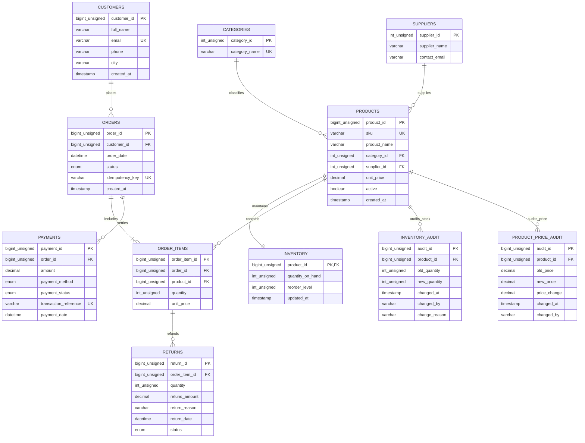

# Retail Management System: Technical Architecture & System Documentation

## 1. Domain Overview
The Retail Management System is an enterprise MySQL transactional database (OLTP) supporting end-to-end retail operations: customer lifecycle, product catalogs, supplier procurement, 1:1 real-time inventory management, sales orders with immutable line items, payment gateway reconciliation, returns tracking, and full ACID audit logging.

---

## 2. Entity-Relationship Diagram (ERD)



---

## 3. Core Architectural Assumptions
1. **Single-Currency Pricing**: All monetary values (`unit_price`, `amount`, `refund_amount`) are denominated in INR (₹) and stored as `DECIMAL(12, 2)` to eliminate floating-point arithmetic inaccuracies.
2. **Pessimistic Locking for Stock Reservation**: Inventory updates utilize `SELECT ... FOR UPDATE` inside `sp_reserve_inventory` to ensure zero overselling during flash-sale or high-concurrency periods.
3. **Price Freezing at Order Creation**: Line items in `order_items` record the historical `unit_price` at the moment of checkout, ensuring product catalog price updates do not retrospectively alter finalized sales.
4. **Idempotency Guarantee**: Orders accept a unique `idempotency_key` preventing duplicate order creation caused by network drops or double-clicking customers.
5. **Reconciliation Independence**: Payment reconciliation aggregates orders and payments in separate Common Table Expressions (CTEs) before joining, avoiding Cartesian multiplication anomalies.

---

## 4. Setup & Execution Instructions

### Prerequisites
- MySQL 8.0+ / MariaDB 10.5+
- Python 3.8+ (for synthetic benchmark generation)
- Bash shell (macOS / Linux)

### Execution Order
```bash
# 1. Initialize schema and database
mysql -u root -p < database/schema/create_db.sql

# 2. Seed initial master data
mysql -u root -p < database/seed/insert.sql

# 3. Verify initial row counts
mysql -u root -p < database/tests/verify_row_count.sql

# 4. Execute all core labs (Lab 3 to Lab 17)
mysql -u root -p < labs/lab03_filtering_sorting.sql
mysql -u root -p < labs/lab04_safe_update_delete.sql
mysql -u root -p < labs/lab05_joins.sql
mysql -u root -p < labs/lab06_aggregations.sql
mysql -u root -p < labs/lab07_subqueries_window.sql
mysql -u root -p < labs/lab08_views.sql
mysql -u root -p < labs/lab09_indexing_explain.sql
mysql -u root -p < labs/lab10_transactions_sp.sql
mysql -u root -p < labs/lab11_audit_trigger.sql
mysql -u root -p < labs/lab12_payment_reconciliation.sql
mysql -u root -p < labs/lab13_low_stock_report.sql
mysql -u root -p < labs/lab14_customer_orders_sp.sql
mysql -u root -p < labs/lab15_security_rbac.sql
mysql -u root -p < labs/lab17_acceptance_tests.sql

# 5. Execute Student Assignments
mysql -u root -p < assignments/assignment01_returns.sql
mysql -u root -p < assignments/assignment02_tax_discounts.sql
mysql -u root -p < assignments/assignment03_monthly_report.sql
mysql -u root -p < assignments/assignment04_lag_growth.sql
mysql -u root -p < assignments/assignment05_top_products_by_category.sql
mysql -u root -p < assignments/assignment06_price_audit.sql
mysql -u root -p < assignments/assignment07_idempotency.sql
```

---

## 5. Known Limitations & Production Enhancements
1. **Multi-Region & Distributed Writes**: Built on a single MySQL primary instance. High-volume global deployments would require read-replicas for view queries and horizontal sharding.
2. **External Gateway Two-Phase Commit**: MySQL ACID transactions cannot hold distributed locks on external Stripe/Razorpay payment APIs. Real-world payment flows require eventual consistency, webhooks, and dead-letter queues.
3. **Partitioning**: For multi-million row order histories, range partitioning by year/month on `orders(order_date)` is recommended.
